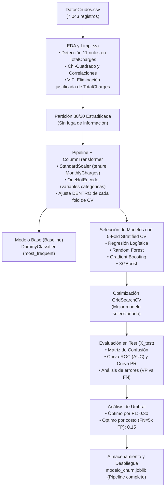

# 📡 Telco Customer Churn Prediction

> Proyecto desarrollado para el curso **Modelos y Simulación de Sistemas I** — Universidad de Antioquia (UdeA).

<div align="center">

### Modelo de Machine Learning Supervisado para la Detección Temprana de Fuga de Clientes

<p>
  Identificación proactiva de clientes en riesgo de deserción en servicios de telecomunicaciones mediante modelos de ensamble y optimización de hiperparámetros.
</p>


[](https://colab.research.google.com/github/CaroGomezO/telco-customer-churn-prediction/blob/main/fase-1/Telco_Customer_Churn_Pipeline_Completo.ipynb)

</div>


## Integrantes del Equipo
* **Carolina Gómez Osorno** — [@CaroGomezO](https://github.com/CaroGomezO)
* **Julian Esteban Hurtado Serna** — [@Julian-debug-s](https://github.com/Julian-debug-s)
* **Emanuel López Franco** — [@ema28pro](https://github.com/ema28pro)

## Descripción del Problema

En la industria de telecomunicaciones, la deserción de clientes (*Customer Churn*) representa uno de los mayores impactos sobre los ingresos y la cuota de mercado. Atraer a un nuevo cliente cuesta entre 5 y 25 veces más que retener a uno existente.

Este proyecto aborda la necesidad de una empresa de telecomunicaciones de identificar de forma automatizada y temprana qué usuarios presentan una alta probabilidad de cancelar su suscripción en el próximo ciclo, permitiendo al área de fidelización diseñar ofertas y retenciones preventivas antes de que el cliente abandone el servicio.

## Objetivo del Modelo

Diseñar, entrenar, optimizar y almacenar un modelo de aprendizaje automático supervisado capaz de:
1. Clasificar binariamente si un cliente cancelará o no su servicio (`Churn = Yes` / `Churn = No`).
2. Priorizar el **Recall** (capturar a la mayor cantidad posible de clientes en fuga) sin degradar excesivamente la **Precisión** (evitar costos de retención innecesarios en falsas alarmas), evaluado formalmente a través del **F1-score** y el **ROC-AUC**.


##  Fuente del Conjunto de Datos

* **Origen:** Dataset público *Telco Customer Churn* de IBM Cognos Analytics / [Kaggle](https://www.kaggle.com/datasets/blastchar/telco-customer-churn). Son datos de ejemplo de una **empresa de telecomunicaciones ficticia**.
* **Observaciones:** 7,043 clientes.
* **Variables:** 21 características iniciales (información demográfica, servicios contratados de telefonía/internet, tipo de contrato, facturación y la variable objetivo `Churn`).
* **Tratamiento de nulos:** Se detectaron 11 registros no numéricos en `TotalCharges` correspondientes a usuarios nuevos con antigüedad de 0 meses (`tenure == 0`).
* **Tratamiento de multicolinealidad:** Mediante el Factor de Inflación de la Varianza (VIF), se evidenció una colinealidad crítica en `TotalCharges` (VIF > 9.5), procediendo a su eliminación técnica justificada para preservar únicamente `tenure` y `MonthlyCharges` (VIF resultante = 1.07).


## Alcance y Limitaciones de los Resultados

* **Datos de una empresa ficticia:** IBM publicó este conjunto como dato de ejemplo. Describe una compañía de telecomunicaciones inventada (7,043 clientes en California durante un trimestre). No son clientes reales de ninguna empresa.
* **No son evidencia sobre clientes reales de operadores colombianos ni de ningún otro operador real:** Los patrones que aprende el modelo son propios de este conjunto de ejemplo y podrían no cumplirse en otro mercado.
* **El valor del trabajo es metodológico:** muestra cómo construir, validar y documentar un modelo de forma reproducible. Para un uso real habría que reentrenarlo y validarlo con datos propios del operador.


## Momento de observación
- **Momento de observación:** el conjunto de datos representa un corte transversal. Cada fila describe a un cliente con los servicios, el contrato y la facturación que tenía en el momento del corte. No hay historial de cada cliente.
- **Horizonte de predicción:** el modelo estima la probabilidad de que el cliente cancele el servicio en el **próximo ciclo de facturación (aproximadamente 30 días)**. Este horizonte es una convención razonable dado que el dataset no especifica explícitamente la ventana temporal, pero debe declararse para interpretar correctamente las predicciones.
- **Consecuencia:** el modelo *clasifica* clientes a partir de su perfil en el corte transversal; con estos datos no se puede verificar que prediga el futuro.


## Algoritmos Evaluados y Modelo Seleccionado

Se compararon cuatro familias de algoritmos supervisados utilizando **validación cruzada estratificada de 5 divisiones (`StratifiedKFold`)** para garantizar solidez estadística:

| Algoritmo | Accuracy (CV) | Precision (CV) | Recall (CV) | F1-Score (CV) | ROC-AUC (CV) | Consistencia (Std F1) |
| :--- | :---: | :---: | :---: | :---: | :---: | :---: |
| **Gradient Boosting** | **80.5%** | **66.9%** | **53.0%** | **0.591** | **0.848** | **± 0.019** |
| **Regresión Logística** | 80.2% | 65.3% | 54.0% | 0.590 | 0.845 | ± 0.028 |
| **XGBoost** | 78.3% | 61.1% | 51.0% | 0.555 | 0.822 | ± 0.023 |
| **Random Forest** | 78.2% | 61.6% | 47.8% | 0.538 | 0.811 | ± 0.022 |

* **Modelo Final Seleccionado:** **`GradientBoostingClassifier`**, optimizado vía `GridSearchCV` (`learning_rate=0.1`, `max_depth=3`, `n_estimators=100`), debido a su balance superior de F1 y su consistencia estadística entre pliegues.

> **Nota metodológica:** los valores de esta tabla se calcularon con el preprocesamiento integrado dentro de un `Pipeline` de scikit-learn, de modo que `StandardScaler` y `OneHotEncoder` se ajustan **dentro de cada fold** de la validación cruzada. Este es el método correcto para evitar fuga de información entre folds. Los valores pueden diferir ligeramente de versiones anteriores del notebook.
>
> **Nota sobre Gradient Boosting vs Regresión Logística:** la diferencia de F1 entre ambos modelos (0.591 vs 0.590) es muy pequeña y está dentro del margen de variabilidad entre folds (± 0.019 vs ± 0.028). Por lo tanto, **no debe interpretarse como una superioridad concluyente** de un modelo sobre el otro. La elección de GB responde a su ligera ventaja y a su capacidad para capturar relaciones no lineales, pero no a una diferencia estadísticamente robusta.

## Métricas Empleadas y Justificación

Dado que la variable objetivo `Churn` presenta un **desbalance natural de clases** (~73.5% No Churn vs. ~26.5% Churn), la métrica tradicional de *Accuracy* resulta engañosa: un modelo trivial que predijera que ningún cliente se va obtendría 73.5% de acierto pero sería 100% inútil para el negocio.

Por ello, se seleccionaron:
* **F1-Score (Métrica rectora de optimización):** Media armónica entre Precisión y Recall sobre la clase positiva (`Churn = 1`).
* **ROC-AUC:** Capacidad de discriminación probabilística del modelo en todos los umbrales de corte posibles.
* **Recall / Sensibilidad:** Porcentaje de desertores reales que son detectados a tiempo.


## Principales Resultados Obtenidos

Sobre el conjunto de prueba independiente (`X_test`, 1,409 clientes no vistos del conjunto de ejemplo ficticio):

* **Superación del Modelo Base:** El clasificador base (`DummyClassifier`) obtuvo un F1 y Recall de **0.00**. El modelo predictivo final alcanzó un **F1 de 0.579** y un **ROC-AUC de 0.843**.
* **Detección Efectiva:** Identifica con éxito al **51.1% de los clientes en riesgo** (Recall = 0.511) con una precisión del **66.8%** (Precision = 0.668), superando ampliamente la nula capacidad de detección del modelo base.
* **Variables Más Determinantes:** El análisis de importancia de variables reveló que los factores que más impulsan el abandono son:
  1. Contrato mes a mes (`Contract_Month-to-month`).
  2. Baja antigüedad (`tenure`).
  3. Cargos mensuales elevados (`MonthlyCharges`).
  4. Tipo de servicio de internet de fibra óptica sin servicios de seguridad/soporte añadidos.

## Análisis del Umbral de Decisión

El umbral de 0.5 usado por defecto no es necesariamente el óptimo para el negocio. En churn, los errores no cuestan lo mismo:
- **Falso Negativo (FN):** un cliente se va y no lo detectamos → perdemos el cliente (costoso).
- **Falso Positivo (FP):** un cliente se queda pero lo marcamos como riesgo → retención innecesaria (menos costoso).

Asumiendo que un FN cuesta **5 veces más** que un FP (valor típico en churn), se analizó el costo total para distintos umbrales **sobre el conjunto de entrenamiento (validación cruzada)**, reservando el test para la evaluación final.

| Umbral | Precision | Recall | F1 | FN | FP | Costo total |
| :---: | :---: | :---: | :---: | :---: | :---: | :---: |
| **0.15** (óptimo por costo) | 0.450 | **0.892** | 0.599 | **161** | 1628 | **2433** |
| **0.30** (óptimo por F1) | 0.543 | 0.764 | **0.635** | 353 | 960 | 2725 |
| **0.50** (actual) | **0.668** | 0.530 | 0.591 | 703 | **394** | 3909 |

**Hallazgos principales:**

1. **El umbral 0.50 no es óptimo ni por F1 ni por costo.** Fue una elección arbitraria inicial, no una decisión basada en el negocio.
2. **Si el objetivo es maximizar F1**, el umbral óptimo es **0.30** (F1 = 0.635 vs 0.591 con 0.50).
3. **Si el objetivo es minimizar el costo total** (FN = 5× FP), el umbral óptimo es **0.15**, que reduce el costo de **3909 a 2433** (una reducción del **37.8%**).
4. **La elección del umbral depende del contexto de negocio.** Si el costo de perder un cliente es mucho mayor que el de una retención innecesaria, conviene bajar el umbral. Si el equipo de retención tiene capacidad limitada, conviene subirlo.


## Almacenamiento del Modelo

**Archivo:** [`modelo_churn.joblib`](./modelo_churn.joblib)

Contiene un **`Pipeline` completo de scikit-learn** que incluye:
- El preprocesamiento (`ColumnTransformer` con `StandardScaler` para numéricas y `OneHotEncoder` para categóricas).
- El clasificador (`GradientBoostingClassifier`).

Esto significa que el modelo **acepta datos crudos** (las 18 variables originales) y realiza internamente la transformación, sin necesidad de preprocesar manualmente antes de predecir. Se puede cargar con `joblib.load()` y usar directamente con `.predict()` o `.predict_proba()` sobre datos nuevos.

**Ejemplo de uso:**
```python
import joblib
import pandas as pd

modelo = joblib.load("modelo_churn.joblib")
datos_nuevos = pd.read_csv("clientes_nuevos.csv")  # 18 variables originales
probabilidades = modelo.predict_proba(datos_nuevos)[:, 1]
predicciones = modelo.predict(datos_nuevos)
```

## Instrucciones para Ejecutar el Proyecto

### 1. Clonar el repositorio y entrar a la carpeta de Fase 1

```bash
git clone https://github.com/CaroGomezO/telco-customer-churn-prediction.git
cd telco-customer-churn-prediction/fase-1
```

> **Importante:** todos los comandos siguientes deben ejecutarse **desde la carpeta `fase-1`**, que es donde están el notebook, el `DatosCrudos.csv` y el `requirements.txt`.

### 2. Crear y activar un entorno virtual (Recomendado)
```bash
# En Windows (PowerShell)
python -m venv .venv
.venv\Scripts\Activate.ps1

# En Linux / macOS
python3 -m venv .venv
source .venv/bin/activate
```

### 3. Instalar las dependencias
```bash
pip install -r requirements.txt
```

### 4. Ejecutar el Notebook
Puedes abrir y ejecutar el notebook completo en **VS Code**, **Jupyter Notebook** o **JupyterLab**:

```bash
jupyter lab
```

Abre y ejecuta las celdas secuencialmente en:
* **`Telco_Customer_Churn_Pipeline_Completo.ipynb`** *(Notebook integral de principio a fin: desde DatosCrudos.csv hasta el modelo serializado)*.


## Flujo del Pipeline (Arquitectura)


